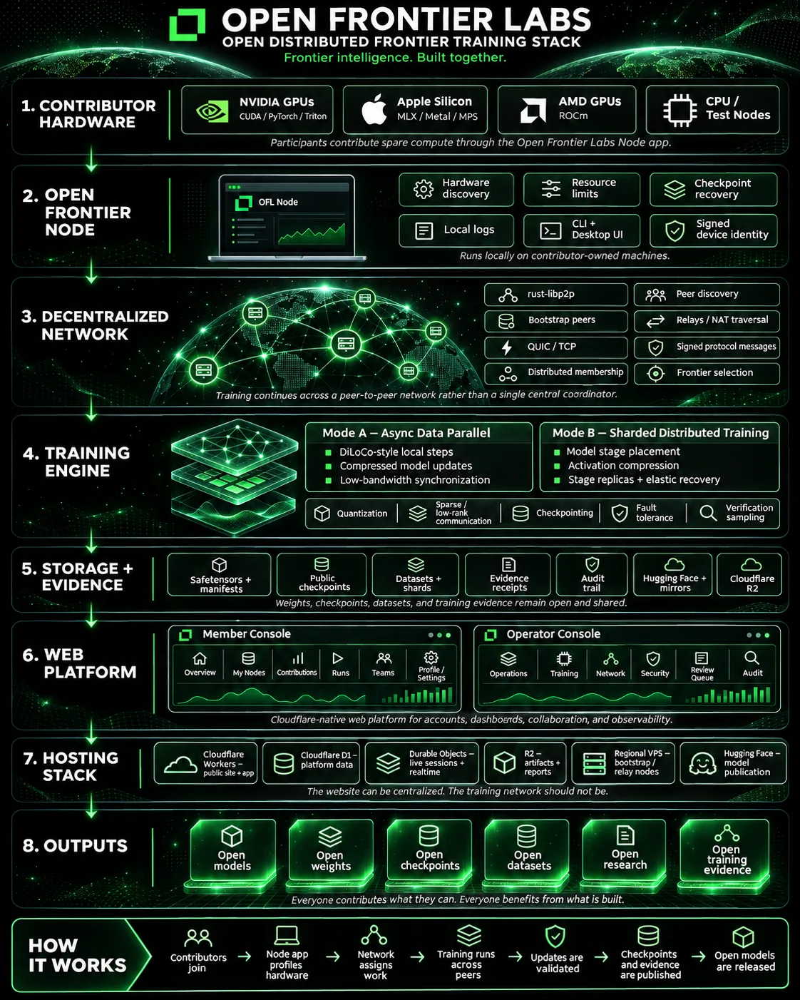

# Architecture

The intended Open Frontier Labs stack, layer by layer, with what exists **in this repository today** and what is planned. Nothing has been trained. Except where a layer says otherwise, it is planned and no code for it exists anywhere in this repo.

How it is meant to work: contributors join; the Node app profiles their hardware; the network assigns work; training runs across peers; updates are validated; checkpoints and evidence are published; open models are released. The website can be centralised; the training network should not be.

## Status at a glance

| # | Layer | In this repo today |
| --- | --- | --- |
| 1 | Contributor hardware | `ofl doctor` reports GPU, CUDA, ROCm, MPS, disk, clock and latency. CPU nodes run the smoke tests. |
| 2 | Open Frontier Node | Nothing. The `ofl` CLI is a developer tool, not the node. |
| 3 | Decentralized network | Nothing. |
| 4 | Training engine | Mode A: a CPU reference DiLoCo, a pinned prime-diloco config, and single-node launchers for the islands. Mode B: nothing. |
| 5 | Storage + evidence | Dataset manifests, pinned upstreams, and a compute-ledger schema with validator. No checkpoints or receipts. |
| 6 | Web platform | Nothing in this repo. |
| 7 | Hosting | Nothing in this repo. |
| 8 | Outputs | Nothing. No models, weights, checkpoints or datasets have been produced. |

## 1. Contributor hardware

Planned: NVIDIA GPUs (CUDA, PyTorch, Triton), Apple Silicon (MLX, Metal, MPS), AMD GPUs (ROCm), and CPU/test nodes, contributed through the Node app.

Today: `ofl doctor` (`src/ofl/doctor.py`) checks Python, torch, GPU (NVIDIA CUDA, AMD ROCm, and Apple MPS), free disk, clock skew and round-trip latency to github.com and huggingface.co. It does not measure bandwidth. The single-node launchers target NVIDIA only; CPU runs only the smoke tests. Nothing has been tested on Apple Silicon or ROCm.

**Next milestones**
- Run `make smoke` on Apple Silicon (MPS) and on a ROCm machine, and record which steps pass.
- Measure bandwidth, not just latency, since Mode A's sync cost depends on it.

## 2. Open Frontier Node

Planned: a local app on contributor machines with hardware discovery, resource limits, checkpoint recovery, local logs, a CLI plus desktop UI, and a signed device identity.

Today: none of this exists. `ofl` (`src/ofl/cli.py`) is a repo developer CLI: setup, checks, smoke tests and launchers. The planned `ofl join` described in [join-a-node.md](join-a-node.md) has no code.

**Next milestones**
- Decide whether the node grows out of `ofl` or is a separate binary, and record the decision.
- A headless node that runs an assigned Mode A worker under user-set GPU, memory and time limits, writing local logs.
- Generate and persist a device keypair; sign the node's hardware report with it.
- Resume a worker from its last local checkpoint after a crash.
- Desktop UI on top of the headless node.

## 3. Decentralized network

Planned: rust-libp2p with bootstrap peers, QUIC/TCP, distributed membership, peer discovery, relays and NAT traversal, signed protocol messages, and frontier selection, so training continues across peers rather than through one central coordinator.

Today: nothing. The reference DiLoCo smoke uses `torch.distributed` with the gloo backend on one machine; that is a test harness, not a network. prime-diloco, which Mode A plans to build on, uses its own elastic device mesh, not libp2p.

**Next milestones**
- A rust-libp2p peer that joins via bootstrap peers and discovers others over QUIC, with a TCP fallback.
- Signed protocol messages bound to the node's device identity (layer 2).
- Membership that tolerates peers leaving mid-round.
- Relay and NAT traversal tested between two home networks.
- Carry one Mode A pseudo-gradient exchange over the network instead of gloo.

## 4. Training engine

### Mode A: async data parallel

DiLoCo-style local steps, compressed model updates, low-bandwidth sync. This is the mode the repo has started on, as phase 3 ([phase3-diloco.md](phase3-diloco.md)):

- **DiLoCo reference** (`src/ofl/smoke/diloco_ref.py`, run by `make smoke`): the DiLoCo algorithm in plain PyTorch on CPU. Two workers run inner AdamW, average the pseudo-gradient, and take an outer Nesterov SGD step. The smoke fails unless the loss falls, workers diverge during inner steps, and they are bit-identical after each sync. It proves the algorithm, on a toy model; it is not prime-diloco and does no compression.
- **prime-diloco config** (`configs/phase3-diloco/diloco-1b.toml`): a 1B config in the pinned upstream's format, with `uint8` pseudo-gradient compression. `ofl diloco launch` exits with `not built`. The upstream needs CUDA and has not been run.
- **OLMo-core launcher** (`src/ofl/run0.py`, `ofl run0 launch`): builds the real single-node OLMo-core command for the 1B dense baseline. In Mode A each island is such a single-node trainer, so this is the island's inner trainer. It has not run on a GPU. The Megatron-LM MoE launcher (`src/ofl/moe.py`) is the same for the MoE track.
- **Compute ledger** (`ledger/schema.json`, `src/ofl/ledger.py`): Mode A's contribution accounting. `islands[]` records the islands and their donors; `nodes[]` records each node's GPU-hours, tokens and `helpful_update_share`, the fraction of its submitted updates that lowered the loss. The schema and validator exist; nothing produces `helpful_update_share` yet, because no update scoring exists. See [layer 5](#5-storage--evidence).

### Mode B: sharded distributed training

Model stage placement, activation compression, stage replicas and elastic recovery. Nothing exists.

### Shared

Quantization, sparse/low-rank communication, checkpointing, fault tolerance, verification sampling. Today: the OLMo-core smoke checks a checkpoint is written; prime-diloco's `uint8` all-reduce is configured but unrun. No verification sampling exists.

**Next milestones**
- Run Run 0 (the OLMo-core 1B baseline) on one GPU node and publish its logs.
- Run prime-diloco's own debug config on GPUs, then `diloco-1b.toml` across two single-node islands.
- Implement `ofl diloco launch`.
- Measure loss parity between the DiLoCo run and the single-node baseline at matched tokens.
- Verification sampling: recompute a sample of submitted updates and compare.
- Mode B: a two-stage pipeline-parallel prototype on two machines before any activation compression.

## 5. Storage + evidence

Planned: safetensors plus manifests, public checkpoints, datasets and shards, evidence receipts, an audit trail, Hugging Face plus mirrors, and Cloudflare R2.

Today:
- **Manifests**: dataset ids, licences and revisions in `manifests/datasets.toml`; every upstream pinned to a commit in `configs/upstreams.toml`. `make check` validates both.
- **Compute ledger** (`ledger/schema.json`, `src/ofl/ledger.py`): a schema and validator for who contributed compute to a run. Only an example file exists; `helpful_update_share` has no producer. See [ledger/README.md](../ledger/README.md).
- `ofl deploy --env huggingface` exits with `not implemented`. No checkpoints, receipts or uploads exist.

**Next milestones**
- First real ledger file, from Run 0.
- Publish Run 0 checkpoints as safetensors with a manifest to Hugging Face via `ofl deploy`.
- Mirror artifacts to R2.
- Define an evidence receipt per checkpoint (config, upstream pins, data revisions, hashes, logs) and publish it with the checkpoint.
- Compute `helpful_update_share` from Mode A verification results.

## 6. Web platform

Planned, Cloudflare-native: a Member Console (Overview, My Nodes, Contributions, Runs, Teams, Profile/Settings) and an Operator Console (Operations, Training, Network, Security, Review Queue, Audit).

Today: nothing in this repo. The public website lives outside this repository; neither console exists.

**Next milestones**
- Runs page reading published ledger and receipt files.
- Member Console sign-in and My Nodes, once nodes have identities (layer 2).
- Operator Review Queue for flagged updates, once verification sampling exists (layer 4).

## 7. Hosting

Planned: Cloudflare Workers (public site and app), D1 (platform data), Durable Objects (live sessions and realtime), R2 (artifacts and reports), regional VPS (bootstrap and relay nodes), Hugging Face (model publication).

Today: nothing in this repo is hosted.

**Next milestones**
- Hugging Face organisation repo for Run 0 artifacts.
- R2 bucket for mirrors and reports.
- One bootstrap/relay node on a regional VPS once the layer 3 peer exists.
- D1 and Durable Objects when the consoles need them.

## 8. Outputs

Planned: open models, weights, checkpoints, datasets, research and training evidence, under the licences in the [README](../README.md#what-is-open).

Today: none. Nothing has been trained.

**Next milestones**
- Run 0: a 1B dense baseline with every checkpoint, the logs (including failures) and the ledger.
- The first Mode A model trained across islands.
- A write-up comparing the Mode A run against the single-node baseline.
